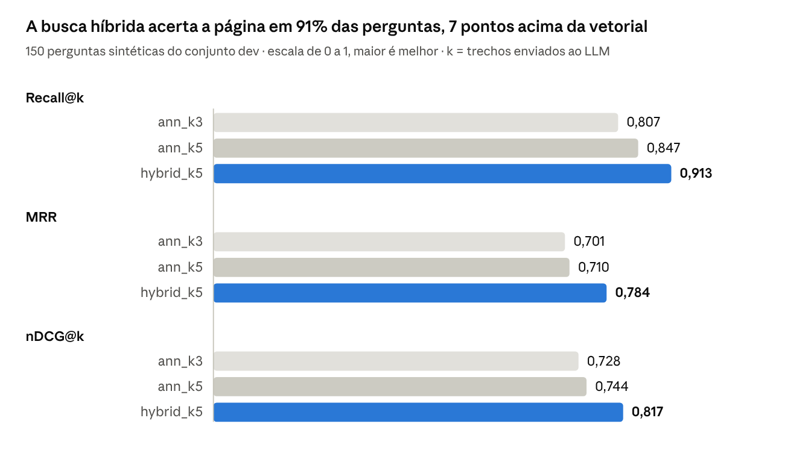
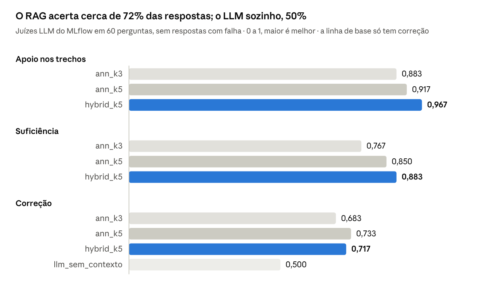

# RAGMarillion — métricas da avaliação

Atualizado em 28/10/2026 · velosomn

Na primeira avaliação com 150 perguntas sintéticas, a busca híbrida com 5 trechos recuperou a página certa em 91,3% das perguntas, contra 84,7% da busca só vetorial com o mesmo número de trechos; é a configuração que o projeto usa. Na correção das respostas, as configurações de busca empatam dentro da variação dos juízes, e o LLM sozinho, sem busca, acerta 0,5. O prompt v2 subiu a correção de 0,73 para 0,80 sem aumentar as recusas indevidas. Dos erros de correção analisados, a maioria vinha do gabarito sintético ou do juiz, não do RAG.

Este documento descreve primeiro cada métrica e depois discute os resultados.

## As métricas

O notebook 06 mede três coisas separadas: se a busca trouxe o trecho certo, se o sistema recusa quando o livro não tem a resposta e se a resposta final está boa. Todas vão de 0 a 1 e, salvo a recusa indevida, quanto maior, melhor. Cada uma é calculada por pergunta e depois tirada a média.

**Busca pela página** (só nas perguntas com `evidence_pages`, as sintéticas e as manuais marcadas). Um trecho recuperado conta como relevante se cobre a página onde está a resposta. Como a página não depende do chunking, a mesma marcação serve para comparar qualquer configuração.

| Métrica (nome no MLflow) | O que mede | Como é calculada, por pergunta |
| --- | --- | --- |
| Recall@k (`recall_at_k`) | Se a resposta chegou ao LLM | 1 se algum dos trechos enviados cobre a página da resposta, senão 0 |
| MRR (`mrr`) | O quão perto do topo está o primeiro trecho certo | 1 ÷ posição do primeiro trecho relevante: 1º lugar vale 1; 2º, 0,5; 3º, 0,33; nenhum, 0 |
| nDCG@k (`ndcg_at_k`) | O mesmo que o MRR, com desconto mais suave pela posição | 1 ÷ log₂(1 + posição): 1º lugar vale 1; 2º, 0,63; 3º, 0,5; nenhum, 0 |
| Precisão@k (`precision_at_k`) | Quanto do contexto enviado é útil | Trechos relevantes ÷ trechos enviados. Depende de k: só compare configurações com o mesmo k |
| Palavras de contexto (`context_words`) | Quanto texto vai ao LLM | Soma das palavras dos trechos enviados. Uma estratégia que manda mais trechos ganha recall só pelo volume |
| (`n_with_pages`) | Base de cálculo | Quantas perguntas têm páginas marcadas e entraram nas métricas acima |

**Busca por termos** (todas as perguntas com resposta). É uma aproximação: conta como acerto qualquer trecho que contenha um termo esperado, mesmo que seja de outra parte do livro. "Fëanor" aparece em dezenas de capítulos.

| Métrica | O que mede | Como é calculada, por pergunta |
| --- | --- | --- |
| hit@k por termos (`hit_terms`) | Se algum trecho menciona a resposta | 1 se algum dos trechos contém algum termo esperado, senão 0 |
| MRR por termos (`mrr_terms`) | Posição do primeiro trecho com um termo esperado | 1 ÷ posição, como o MRR |

**Recusa.**

| Métrica | O que mede | Como é calculada, por pergunta |
| --- | --- | --- |
| Taxa de recusa (`refusal_rate_unanswerable`) | Nas perguntas sem resposta no livro, se o sistema admite que não sabe em vez de inventar | 1 se a resposta contém "Não encontrei isso nos trechos recuperados", senão 0. Quanto maior, melhor |
| Recusa indevida (`false_refusal_rate`) | Nas perguntas com resposta, se o sistema recusou mesmo assim | Fração das respostas da amostra dos juízes que são a frase de recusa. Quanto menor, melhor: é o custo de um prompt cauteloso |

**Juízes LLM** (numa amostra de 60 perguntas, por custo). Um modelo lê a pergunta, a resposta e, conforme o juiz, os trechos recuperados e a resposta esperada, e dá sim (1) ou não (0) com uma justificativa. São os juízes prontos do MLflow 3.

| Métrica | Pergunta que o juiz responde | O que compara |
| --- | --- | --- |
| Correção (`correctness`) | A resposta está certa? | Resposta do sistema × resposta esperada do gabarito |
| Apoio nos trechos (`retrieval_groundedness`) | O que a resposta afirma está nos trechos recuperados? | Resposta × trechos. Pega o modelo respondendo de memória ou inventando |
| Suficiência (`retrieval_sufficiency`) | Os trechos recuperados bastavam para chegar à resposta esperada? | Trechos × resposta esperada. Avalia a busca sem depender da página exata, útil quando a resposta aparece em vários lugares |

Na linha de base sem contexto só existe a correção: sem busca, não há trechos para os outros dois juízes avaliarem. Respostas que não chegam a ser geradas (falha de chamada) são contadas em `n_failed_answers`, e o 06 dá ERRO se houver alguma, porque o juiz as trataria como erradas.

## O que foi avaliado

Três configurações de busca e uma linha de base, todas sobre o mesmo gabarito e com o mesmo LLM (Llama 3.3 70B) gerando as respostas.

| Configuração | Busca | Trechos enviados ao LLM |
| --- | --- | --- |
| `ann_k3` | Vetorial: trechos de significado mais parecido com a pergunta | 3 |
| `ann_k5` | Vetorial | 5 |
| `hybrid_k5` | Híbrida: vetorial somada à busca por palavra-chave | 5 (configuração atual do projeto) |
| `llm_sem_contexto` | Nenhuma: o LLM responde de memória | 0 |

Os pares isolam uma mudança de cada vez: `ann_k3` × `ann_k5` mostra o efeito de mandar mais trechos, e `ann_k5` × `hybrid_k5` mostra o efeito da busca por palavra-chave.

**Gabarito (conjunto `dev`):**

- 150 perguntas sintéticas, geradas pelo notebook 06a a partir de chunks sorteados da história; são elas que têm páginas marcadas e entram nas métricas de busca pela página;
- 7 perguntas manuais na primeira rodada: 5 com resposta (factual, apelidos, nomes parecidos e uma de vários saltos, a de Lúthien e Elrond) e 2 sem resposta no livro; depois entraram 2 de consistência, sobre os anéis de poder;
- os juízes avaliaram 60 perguntas: as manuais com resposta e as demais sintéticas, a mesma amostra para todas as configurações.

O conjunto `test` (cerca de um terço das perguntas) não foi usado: fica reservado para confirmar a configuração escolhida, uma vez só.

## Resultados da busca

A busca por palavra-chave é o que mais pesa: com o mesmo número de trechos, a híbrida sobe o recall de 0,847 para 0,913 e põe o trecho certo mais perto do topo. As perguntas citam nomes próprios, e é neles que a busca só vetorial falha.

- **A diferença não parece ruído.** A comparação é pareada, nas mesmas perguntas: nas listas de erros visíveis, pelo menos 8 perguntas são acertadas só pela híbrida, contra 2 (`s003` e `s015`) acertadas só pela vetorial. No total, a híbrida erra 14 perguntas; a vetorial com 5 trechos, 24; com 3, 30.
- **Mais trechos ajudam menos:** de 3 para 5 trechos, o recall da vetorial sobe 4 pontos, e o MRR quase não muda, porque o trecho certo, quando vem, já costuma estar entre os primeiros.
- **Precisão@k fica de fora do gráfico** porque depende de k. Com 5 trechos, a híbrida também traz mais trechos úteis (0,305 contra 0,263 da vetorial).
- **Busca por termos:** 0,98 a 0,99 nas três, alta demais para separar configurações; confirma que ela é uma aproximação fraca.
- **Erros comuns:** 9 perguntas falham nas três configurações. Podem ser falhas de busca ou perguntas ruins no gabarito, e precisam ser conferidas antes de buscar soluções para elas.

A configuração atual do projeto, `hybrid_k5`, é a melhor das três na busca.

## Resultados dos juízes

**Causa confirmada: limite de chamadas.** Na primeira rodada, 30 das 60 respostas da `hybrid_k5` e 32 das 60 da linha de base falharam por excesso de chamadas no Free Edition e foram contadas como incorretas, derrubando a correção para 0,317 e 0,2. O notebook 06 agora repete cada chamada que falha, faz uma pausa entre configurações e dá ERRO se alguma resposta não for gerada. No gráfico, essas duas linhas vêm da segunda rodada, sem nenhuma falha.

**A híbrida empata na correção.** 0,717 contra 0,733 da vetorial com 5 trechos é uma pergunta de diferença em 60. A busca melhor não virou mais acertos nesta amostra.

**Os juízes variam entre rodadas.** A suficiência da híbrida foi 0,917 na primeira rodada e 0,883 na segunda, com exatamente os mesmos trechos: 2 perguntas de diferença só pela variação do juiz. Com 60 perguntas, diferenças de até cerca de 5 pontos nos juízes não devem decidir nada.

**A maior perda está na geração, não na busca.** Em cerca de 88% das perguntas os trechos bastavam, mas só cerca de 72% das respostas estão certas: em uns 10 casos o modelo tinha o necessário e errou. O diagnóstico desses casos está abaixo.

O apoio nos trechos fica alto em todas as configurações (0,88 a 0,97): o modelo responde com base no que recebe, e não de memória.

## Diagnóstico dos erros de correção

Na `hybrid_k5` (prompt v1), 10 perguntas tiveram suficiência "sim" e correção "não": os trechos bastavam, mas a resposta foi julgada errada. Só 3 são falhas do RAG.

| Caso | O que aconteceu | Causa |
| --- | --- | --- |
| `s015` Novo nome de Beren | O livro dá dois nomes (Erchamion e Camlost); o modelo deu um, o gabarito esperava o outro | Gabarito: duas respostas certas |
| `s050` Filha de Morwen e Húrin | Eles tiveram duas filhas (Lalaith e Nienor); o modelo citou a outra | Gabarito: duas respostas certas |
| `s176` O que Sauron desejava? | Pergunta vaga; a resposta detalhada sai do trecho | Gabarito: pergunta vaga |
| `s019` O que aconteceu com Húrin? | A resposta esperada não fala de Húrin | Gabarito: pergunta e resposta não combinam |
| `s031` Espada de Elendil | "Ficou partida" e "quebrou" são o mesmo; o juiz concordou na justificativa e marcou "não" | Juiz inconsistente |
| `s089` Morada de Caranthir | "Helevorn" e "Helevom" (grafia dupla no PDF) | Juiz rígido com a grafia |
| `s016` Glaurung e Túrin | A resposta inclui a libertação; o juiz exigiu a palavra exata | Juiz rígido |
| `q04` Nomes de Túrin | Citou 3 de 4 nomes | RAG: resposta incompleta |
| `s165` O que Sauron disse aos homens | Resumiu só parte do trecho | RAG: resposta incompleta |
| `s168` Amandil após zarpar | Recusou, com a resposta nos trechos | RAG: recusa por cautela |

Se os 7 casos de gabarito e juiz forem descontados, a correção real fica perto de 0,83. Os problemas do gabarito vêm de como o 06a gera as perguntas: uma pergunta pode ter resposta única no trecho, mas mais de uma no livro. O prompt de geração precisa exigir resposta única no livro inteiro.

## Prompt v1 × v2

O v2 pede para afirmar só o que os trechos dizem, com a mesma força ("participou" não vira "criou"), citar o trecho certo, listar todos os itens e responder em parte em vez de recusar. Foi comparado com o v1 na `hybrid_k5`, com o texto já limpo de novo, em 152 perguntas com páginas e 60 nos juízes, sem nenhuma resposta com falha.

| | Correção | Apoio nos trechos | Suficiência | Recusa indevida | Recusa sem resposta |
| --- | --- | --- | --- | --- | --- |
| v1 | 0,733 | 0,950 | 0,917 | 0,049 | 1,0 |
| v2 | 0,800 | 0,933 | 0,867 | 0,033 | 1,0 |

A suficiência só avalia os trechos, que são idênticos nas duas linhas, e mesmo assim variou 5 pontos: é a medida do ruído dos juízes. A correção subiu 6,7 pontos, um pouco acima disso, e a recusa indevida caiu; o v2 virou o padrão. A busca não mudou: Recall@5 de 0,914.

## LLM sem contexto

Com todas as respostas geradas, o Llama 3.3 70B respondendo de memória acertou 0,5 das 60 perguntas, contra cerca de 0,72 do RAG: 22 pontos, ou 13 perguntas. O 0,2 da primeira rodada era efeito das chamadas que falharam.

- **O modelo sabe mais do livro do que o esperado:** acerta de memória metade dos detalhes de trechos sorteados.
- **Mas erra sem avisar e mistura obras:** uma das respostas cita o "Conselho de Elrond" e o Anel encontrado por Bilbo, que são de *O Senhor dos Anéis*, não do Silmarillion.
- **Um viés a favor do RAG continua:** as perguntas foram criadas a partir do texto desta tradução, e o LLM sozinho pode acertar o fato com outras palavras ou outra grafia de nome. O juiz tolera paráfrase, mas não se sabe quanto.

Nas perguntas manuais, mais famosas, a diferença deve ser menor; com 5 delas, não há base para separar.

## Limitações desta rodada

| Limitação | Efeito | Como resolver |
| --- | --- | --- |
| Ruído do gabarito ainda desconhecido | Não se sabe que diferença é pequena demais para importar | Concluir a revisão das 30 perguntas no 06a e registrar a taxa de erro |
| Uma página de evidência por pergunta | Se a resposta também aparece em outra página, a busca que a traz é contada como erro | Olhar a suficiência ao lado do recall; conferir as 9 perguntas que todas as configurações erram |
| Perguntas sintéticas de um trecho só | Nada mede perguntas de vários saltos, como a de Lúthien e Elrond (há só uma no `dev`) | Gerar perguntas de dois trechos e medir o recall completo |
| Juízes numa amostra de 60 | Cada pergunta vale cerca de 0,017 nas médias dos juízes | Ampliar a amostra quando a diferença entre duas configurações for pequena |
| Uma única execução | Respostas e juízes podem variar um pouco entre execuções | Repetir as configurações finalistas |
| Mesmo modelo gera e responde | Com a configuração padrão, o Llama cria as perguntas e também responde a elas, o que tende a deixar a avaliação otimista | Usar outro modelo em `SYNTH_LLM_ENDPOINT`, se houver em Serving |

## Próximos passos

- [x] Verificar a correção da `hybrid_k5` no MLflow: 30 respostas tinham falhado por limite de chamadas.
- [x] Repetir a `hybrid_k5` e a linha de base com novas tentativas e pausas: nenhuma falha na segunda rodada.
- [x] Ver os casos com suficiência "sim" e correção "não": 7 de 10 eram gabarito ou juiz.
- [x] Comparar os prompts v1 e v2: ficou o v2.
- [ ] Registrar a taxa de erro da revisão das 30 perguntas sintéticas.
- [ ] Melhorar o prompt do 06a (resposta única no livro inteiro, sem perguntas vagas) e regerar.
- [ ] Gerar as perguntas sintéticas de dois trechos e acrescentar o recall completo.
- [ ] Avaliar as estratégias de busca (`vizinhos`, `diversa`, `por_nome`), já implementadas, comparando também `context_words`.
- [ ] Ampliar a amostra dos juízes para reduzir o ruído.
- [ ] Corrigir a ordem do Job: o `evaluate` deve depender do `Gabarito`.

O andamento geral do projeto está em [progresso.md](progresso.md), e o raciocínio por trás desta avaliação, em [discussao-avaliacao.md](discussao-avaliacao.md).
