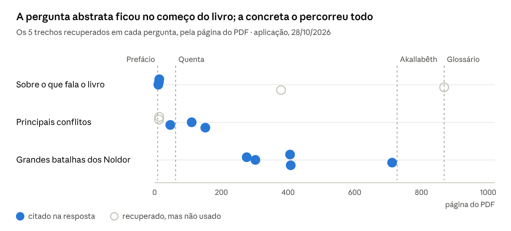

# Perguntas globais: o limite do RAG por trechos

Atualizado em 28/10/2026 · velosomn

Perguntas sobre o livro como um todo ("do que se trata?", "quais são os principais conflitos?") recebem respostas corretas e bem citadas, mas incompletas, e nada no sistema avisa que estão incompletas. Três testes na aplicação, em 28/10/2026, mostraram por quê:

1. **O embedding encontra o tema, mas não a importância.** Quase o livro inteiro é sobre conflito; a busca devolve os 5 trechos mais parecidos com a pergunta, não os 5 mais importantes nem os mais variados.
2. **Pergunta abstrata atrai texto abstrato.** "Principais conflitos" trouxe só trechos das primeiras 154 páginas, de um livro de 1.020; "grandes batalhas dos Noldor", uma pergunta concreta sobre o mesmo tema, trouxe trechos do livro todo.
3. **Perguntas de lista precisam de mais espaço que 5 trechos.** Na lista das grandes batalhas, faltou justamente a maior, a Nirnaeth Arnoediad.
4. **As métricas atuais não pegariam o problema.** Nada foi inventado, então o apoio nos trechos sai alto; o que falta é cobertura, que nenhuma métrica mede.

## Os três testes

Cada linha é uma pergunta feita na aplicação (busca `hybrid_k5`, prompt v2), e cada círculo, um dos 5 trechos que a busca trouxe, na página em que ele começa (página do PDF usado no projeto, que não corresponde ao livro físico). Círculo cheio: citado na resposta; vazio: recuperado, mas não usado.

| Pergunta | Resposta | Avaliação |
| --- | --- | --- |
| "Sobre o que fala este livro?" | O livro vai da Música dos Ainur à partida dos Portadores do Anel e reúne cinco obras, citando 3 trechos do prefácio | Correta e apoiada no texto, mas descreve a estrutura do livro, não o enredo; funcionou porque o prefácio descreve o livro |
| "Quais são os principais conflitos do livro?" | A guerra dos Valar contra Melkor, a discórdia na casa de Finwë e a inveja de Melkor | Correta e citada, mas só cobre as primeiras 154 páginas; faltam os conflitos centrais |
| "Quais foram as grandes batalhas dos Noldor contra Morgoth em Beleriand?" | Dagor-nuin-Giliath, Dagor Aglareb, Dagor Bragollach e a Guerra da Ira | Trechos do livro todo; faltou a Nirnaeth Arnoediad |

## Por que a pergunta abstrata só trouxe o começo do livro

O embedding não errou o tema: os 5 trechos de "quais são os principais conflitos?" falam de conflito (a guerra dos Valar contra Melkor, a inveja de Melkor, a discórdia na casa de Finwë). O problema tem três camadas.

- **Quase o livro inteiro é sobre conflito.** Centenas dos 529 trechos são "parecidos" com a ideia. A busca devolve os 5 mais parecidos, e nada faz esses 5 serem variados ou representativos; entre centenas de candidatos quase igualmente bons, pequenas diferenças decidem quem fica em cima.
- **"Principal" não é propriedade de um trecho.** O embedding mede semelhança com a pergunta, não importância na história. O juramento de Fëanor é central porque move os acontecimentos ao longo de centenas de páginas; isso não está no vetor de nenhum trecho isolado. Um embedding perfeito traria "5 trechos sobre conflitos", nunca "os 5 conflitos mais importantes".
- **Pergunta abstrata atrai texto abstrato.** O vetor de uma pergunta genérica fica perto de trechos que *falam sobre* conflito de forma geral, como a Valaquenta. Uma cena de batalha tem 350 palavras de nomes, lugares e ações, e o vetor dela representa aquela cena específica. A parte por palavra-chave da busca híbrida reforça o efeito: "livro" aparece sobretudo no prefácio, que veio de novo.

Quando a pergunta é concreta, o mesmo embedding acerta: "quais foram as grandes batalhas dos Noldor contra Morgoth em Beleriand?" trouxe 5 trechos de batalhas, das páginas 276 a 714.

## Perguntas de lista: o limite dos 5 trechos

Uma pergunta que pede uma lista precisa de pelo menos um trecho por item. O livro conta cinco grandes batalhas em Beleriand; a primeira foi antes da volta dos Noldor, e as outras quatro são deles.

| Batalha | Na resposta? |
| --- | --- |
| Dagor-nuin-Giliath, a Batalha-sob-as-estrelas | Sim (`c00142`) |
| Dagor Aglareb, a Batalha Gloriosa | Sim (`c00156`) |
| Dagor Bragollach, a Batalha das Chamas Repentinas | Sim (`c00211`, `c00212`) |
| Nirnaeth Arnoediad, as Lágrimas Inumeráveis | **Não**: a mais desastrosa de todas, no capítulo XX |

Com 5 lugares e um deles ocupado por um trecho sobre o ódio de Morgoth, que não nomeia nenhuma batalha, a Nirnaeth ficou de fora. O próprio trecho `c00212` diz "a quarta das grandes batalhas", o que indica que havia uma quinta, e mesmo assim o modelo não avisou que a lista podia estar incompleta. A resposta também citou a Guerra da Ira (`c00370`), do fim da Primeira Era.

## Por que isso é perigoso

A resposta sobre os principais conflitos parece completa: tem estrutura, cita três fontes e todas as afirmações estão nos trechos. Quem não conhece o livro aceitaria. Ficaram de fora justamente os conflitos centrais: o roubo das Silmarils e o juramento de Fëanor, o massacre de Alqualondë, as guerras em Beleriand, Beren e Lúthien, Túrin, as quedas de Gondolin e de Doriath, a Guerra da Ira, a queda de Númenor e os anéis de Sauron.

- **O modelo não sabe que a resposta é parcial.** O prompt v2 pede para dizer o que faltou, mas o modelo só vê os 5 trechos e não tem como saber o que existe no resto do livro.
- **As métricas atuais não pegam o problema.** O apoio nos trechos sai alto, porque nada foi inventado. A correção só pegaria se o gabarito tivesse perguntas globais, e hoje não tem: as sintéticas nascem de um trecho só.
- **Faltam uma categoria e uma métrica.** Perguntas `global` e de lista no gabarito, e uma métrica de cobertura: quantos dos pontos esperados a resposta menciona.

Para a pergunta "do que se trata este livro?", a resposta foi razoável por sorte de estrutura: o livro tem um prefácio que o descreve, e a busca o encontrou. Mesmo assim, a resposta fala da estrutura do livro (de onde vai a história, quais obras reúne), não do enredo.

## Caminhos possíveis

O RAG manda ao modelo 5 trechos, cerca de 1.750 palavras de um livro de 150 mil: pouco mais de 1%. Ele foi feito para perguntas locais, em que a resposta está num ponto do livro. Três técnicas gerais atacam as perguntas globais e de lista, cada uma num ponto diferente.

| Técnica | Como funciona | O que resolve | Custo |
| --- | --- | --- | --- |
| Reformulação da pergunta (*multi-query*) | O LLM transforma a pergunta abstrata em 3 ou 4 buscas concretas ("guerra dos Noldor contra Morgoth", "juramento de Fëanor", "queda de Númenor") e os resultados são intercalados | Perguntas abstratas e de lista; aproveita o código de intercalação da estratégia `por_nome` | Uma chamada a mais ao LLM por pergunta |
| Diversidade (`diversa`, já implementada) | No máximo 2 trechos por capítulo | Listas que atravessam capítulos, como a das batalhas | Nenhum |
| Resumos por capítulo | O LLM resume, uma vez, cada um dos 36 capítulos e o livro inteiro; os resumos ficam num índice separado e entram no contexto junto com os trechos | Perguntas sobre importância e panorama ("principais", "como termina"), que nenhuma busca por trechos resolve: quem resume decide o que é central | Um notebook novo e um índice novo; os resumos ficam no Databricks, como os chunks |

Os resumos vão num índice separado de propósito: no mesmo índice dos trechos, um resumo que cobre as páginas 439 a 520 contaria como acerto de busca para qualquer pergunta daquele capítulo e inflaria o recall. É a ideia de técnicas como o RAPTOR (resumos em níveis); na versão completa, o sistema primeiro classifica a pergunta como geral ou de detalhe e escolhe onde buscar.

## Próximos passos

A ordem vai do mais barato ao mais caro, e nenhuma técnica vira padrão sem ser medida.

- [ ] Acrescentar ao gabarito uma categoria `global`, com 8 a 10 perguntas ("quais são os principais conflitos?", "como termina a história das Silmarils?", "quais foram as cinco grandes batalhas de Beleriand?") e os pontos esperados de cada resposta, conferidos no livro.
- [ ] Criar a métrica de cobertura: quantos dos pontos esperados a resposta menciona.
- [ ] Implementar a estratégia `reformulada` (reformulação da pergunta) e compará-la com a `simples` e a `diversa` nas perguntas globais, conferindo que as perguntas de detalhe não pioram.
- [ ] Se a reformulação não bastar, implementar os resumos por capítulo e a estratégia `com_resumos`.

O andamento geral está em [progresso.md](progresso.md), e as métricas, em [metricas.md](metricas.md).
