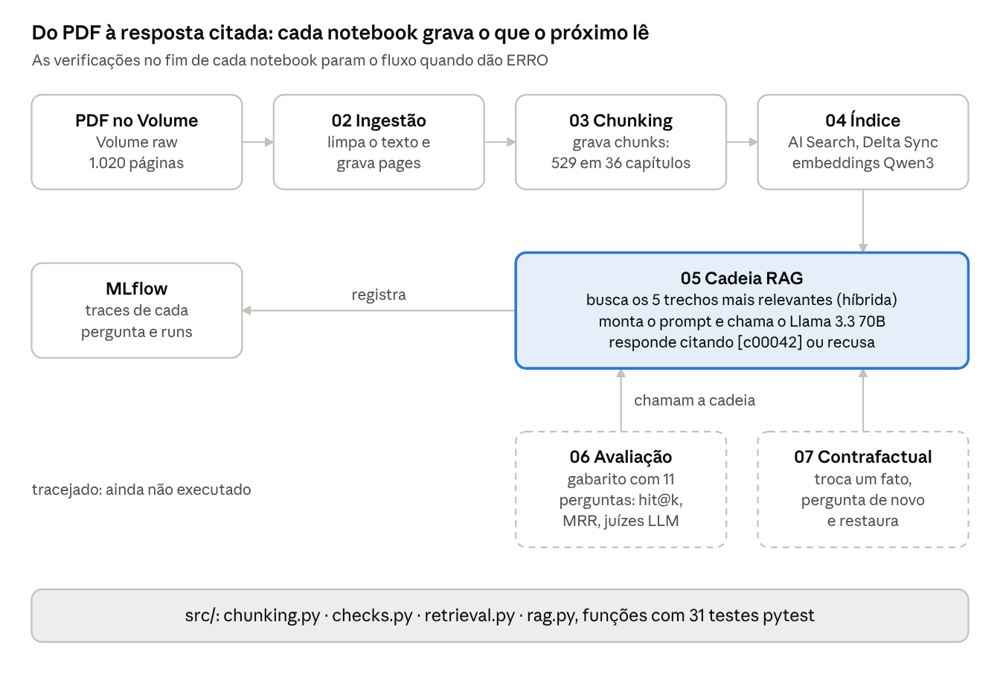

# RAGMarillion — o que foi feito até agora

Atualizado em 28/10/2026 · velosomn

## Visão geral

O RAGMarillion responde perguntas sobre O Silmarillion citando os trechos do livro, roda de ponta a ponta no livro inteiro (1.020 páginas, 529 chunks, 36 capítulos) e já tem uma avaliação com números: a busca híbrida acerta a página da resposta em 91% das perguntas e cerca de 80% das respostas estão corretas com o prompt v2. Dá para perguntar direto do terminal do computador. O teste contrafactual (07) ainda não rodou, e as estratégias de busca estão implementadas mas ainda não avaliadas.

O repositório é público em [github.com/velosomn/RAGMarillion](https://github.com/velosomn/RAGMarillion) e contém só código. O PDF, os chunks e as saídas dos notebooks ficam no Databricks, por causa dos direitos autorais da obra.

| Peça | Escolha |
| --- | --- |
| Plataforma | Databricks Free Edition, computação Serverless (ambiente v6) |
| Armazenamento | Unity Catalog: schema `workspace.ragmarillion`, Volume `raw`, tabelas Delta `pages`, `chunks` e `eval_sintetico` |
| Busca | Databricks AI Search (antigo Vector Search), índice Delta Sync, busca híbrida com 5 trechos |
| Embeddings | `databricks-qwen3-embedding-0-6b` (multilíngue, bom para o PDF em português) |
| LLM | `databricks-meta-llama-3-3-70b-instruct`, temperatura 0, prompt v2 |
| Rastreio e avaliação | MLflow 3 (Tracing, `mlflow.genai.evaluate` e juízes prontos) |
| Aplicação | `app/perguntar.py`, no terminal do computador, usando o índice e o LLM do Databricks |
| Testes locais | pytest, 58 testes sobre limpeza, chunking, verificações, métricas e estratégias de busca |

## Linha do tempo

Em seis dias e 28 commits, o projeto saiu de um zip com a estrutura inicial para um RAG avaliado, com aplicação de terminal. A tabela lista os marcos, do mais recente ao mais antigo.

| Data | Commit | O que mudou |
| --- | --- | --- |
| 28/10 | `58dba24` | Estratégias de busca `vizinhos`, `diversa` e `por_nome`, comparáveis no 06 e na aplicação |
| 28/10 | `71e6864` | O 04 compara o texto do índice com o da tabela e testa a busca com 100 palavras do próprio chunk |
| 28/10 | `3b88cb2` | A limpeza mantém o hífen de nomes compostos partidos no fim da linha (Tol-in-Gaurhoth) |
| 27/10 | `bdbffa2` | O 06 mede a recusa indevida (perguntas com resposta que o modelo recusou) |
| 27/10 | `d81ecae` | Prompt v2, perguntas de consistência (anéis de poder) e limpeza do texto extraído |
| 27/10 | `cfb08ef` | Aplicação de terminal (`app/perguntar.py`) com as fontes citadas |
| 24/10 | `af10ad9` | O 06 repete chamadas que falham e acusa respostas não geradas (limite de chamadas) |
| 24/10 | `6e2a9ec` | Gabarito sintético (06a) e métricas de busca por página no 06 |
| 24/10 | `4f78ba4` | Discussão sobre como avaliar o RAG documentada |
| 24/10 | `444f1d4` | Junção de título guiada pelo regex: corrige "DA QUINTA" e "DE TÚRIN" cortados |
| 24/10 | `ecad647` | O chunking ignora o sumário (páginas com 3 ou mais títulos) |
| 24/10 | `869cac7` | Primeiro push feito pelo Databricks: nome do PDF, modo de teste, regex inicial |
| 23/10 | `616cef2` | Conversão de ligaduras tipográficas (fi, fl) na limpeza do texto |
| 23/10 | `9850d3f` | Troca de `databricks-vectorsearch` por `databricks-ai-search` |
| 23/10 | `af38039` | Verificações por etapa (`src/checks.py`) e modo de teste por páginas |
| 23/10 | `e9890c9` | Renomeação de todo o projeto para RAGMarillion |
| 23/10 | `d083f77` | Estrutura inicial, a partir do zip `silmarillion-rag` |

O repositório começou como `RAGMarilion` (um L) e foi renomeado para `RAGMarillion` no GitHub e na pasta local. O link antigo redireciona para o novo.

## Arquitetura

O fluxo é uma sequência de notebooks em que cada um grava uma tabela ou um índice que o próximo lê. A lógica fica em `src/`, como funções puras testáveis fora do Databricks, e os notebooks só as chamam.



O `00_config` reúne todos os parâmetros e é carregado no início de cada notebook; o `01` prepara o ambiente uma vez.

| Módulo | Papel |
| --- | --- |
| `src/chunking.py` | Limpeza do texto (acentos, ligaduras, hífens), detecção de títulos e sumário, divisão em chunks |
| `src/checks.py` | Todas as verificações ERRO/AVISO e o resumo de cada notebook |
| `src/retrieval.py` | Versões do prompt, estratégias de busca, métricas (hit@k, MRR, Recall@k e nDCG por página), novas tentativas e esperas |
| `src/rag.py` | Classe `RAGMarillion` (busca com estratégia, geração e rastreio no MLflow) e a linha de base sem contexto |
| `src/synth.py` | Prompt e filtros do gabarito sintético |
| `src/answer_format.py` | Fontes citadas e trechos formatados para o terminal |
| `app/perguntar.py` | Aplicação de terminal |

## Ambiente Databricks

O ambiente está montado e funcionando; os problemas que apareceram no caminho estão resolvidos e registrados no código ou no repositório.

**Montagem**

1. Conta no Databricks Free Edition.
2. Git folder em Workspace > Home > Create > Git folder, apontando para o repositório público.
3. Notebook 01: cria o schema, o Volume `raw` e o endpoint de busca `ragmarillion-vs` (ficou ONLINE), e confirma que os dois modelos existem no workspace.
4. Upload do PDF no Volume.

**Problemas e soluções**

| Problema | Causa | Solução |
| --- | --- | --- |
| O Python não reiniciava no `%pip install` | `databricks-vectorsearch` 0.75 exige `protobuf<6`, e o ambiente Serverless v6 vem com o 6.33.5 | Troca pelo sucessor oficial `databricks-ai-search`, mesma API, sem restrição de protobuf |
| Conflito de merge no Pull | Alterações locais no Databricks (o Genie no `01_setup`; linhas comentadas no `06`) na mesma parte que o GitHub mudou | Manter a versão do GitHub ("upstream"); antes de um Pull, descartar alterações locais que não serão enviadas |
| Push do Databricks recusado | A credencial Git não tinha um token com escrita | Token *fine-grained* só para o repositório, com Contents: Read and write, cadastrado como credencial nova |
| `PDF não encontrado` | O arquivo no Volume se chama `O Silmarillion - J.R.R. Tolkien.pdf` | `PDF_FILENAME` ajustado no `00_config`; a mensagem de erro já listava os arquivos do Volume |
| Correção de 0,317 na avaliação | Limite de chamadas do Free Edition: 30 de 60 respostas falharam e contaram como erradas | O 06 repete chamadas, pausa entre configurações e dá ERRO se alguma resposta não for gerada |
| A avaliação rodou sem o gabarito sintético | No Job, a tarefa `evaluate` estava antes da `Gabarito` | `evaluate` passa a depender de `Gabarito` |
| Aplicação local sem acesso (401) | `host` com o caminho da página e um valor que não era o token | `host` só até `.cloud.databricks.com`; token pessoal (`dapi...`) nas variáveis de ambiente, fora do repositório |

O Databricks acrescenta um cabeçalho `environment_version = "6"` aos notebooks que executa. Ele registra a versão do ambiente que funcionou e pode ir para o GitHub.

## Ingestão (notebook 02)

O texto do livro inteiro foi extraído sem perdas e passou em todas as verificações. O notebook lê o PDF página a página com `pypdf`, limpa o texto e grava a tabela `pages`.

**Limpeza aplicada a cada página**

- Normalização de acentos (NFC), para que "Fëanor" codificado de formas diferentes seja a mesma palavra.
- Conversão de ligaduras: o PDF usa caracteres como `fi` (U+FB01), que parecem "fi" na tela mas fariam "filhos" e "filhos" serem palavras diferentes na busca. O teste curto achou 55 ocorrências em 24 páginas.
- Junção de palavras partidas no fim da linha, com hífen comum ou tipográfico e espaços soltos em volta da quebra; o hífen invisível (*soft hyphen*) é removido. Se a continuação começa com maiúscula, é um nome composto e o hífen fica ("Tol-in-Gaurhoth"); se começa com minúscula, são sílabas e o hífen sai ("Ercha-mion" vira "Erchamion").
- Remoção de linhas que são só número de página.

**Resultado no livro inteiro**

| Verificação | Resultado |
| --- | --- |
| Páginas sem texto | 18 de 1.020 (2%); limite 10% |
| Total de palavras | 150.611; mínimo 80.000 |
| Termos-âncora | 8 de 8 encontrados (Fëanor, Silmaril, Morgoth, Valinor, Beleriand, Lúthien, Túrin, Gondolin) |
| Caracteres corrompidos | 0 depois da conversão de ligaduras |
| Palavras grudadas (estimativa) | 25 (0,017%); limite 0,1% |
| Cabeçalho ou rodapé repetido | nenhum |
| Sumário | páginas 5 a 8 |
| Capítulos pelo regex | 36, sem duplicatas |

Com o `CHAPTER_REGEX` definido, o 02 lista exatamente os títulos que o chunking vai usar. Sem ele, mostra linhas candidatas a título para ajudar a escrever o regex.

**Extrator do PDF e palavras grudadas.** O 02 permite escolher o extrator (`pypdf`, `pypdf_layout` ou `pymupdf`) e compara os três numa amostra de 60 páginas. Os três deram o mesmo resultado (cerca de 8.740 palavras e as mesmas 3 palavras grudadas), então o `pypdf` ficou. As palavras grudadas já estão no texto embutido do PDF e são de três tipos: espaço faltando ("porTurgon", "deEglarest"), erro de reconhecimento de texto ("entaIhadas", com I no lugar de l) e texto que não é do livro ("eLivros", "eLivross"), acrescentado ao arquivo de origem. Nenhum extrator resolve esses casos; uma lista de correções conhecidas fica como pendência.

## Chunking (notebook 03)

O livro virou 529 chunks em 36 capítulos, sem nenhuma palavra perdida: 150.209 de 150.209. Cada chunk tem cerca de 350 palavras, com 60 de sobreposição, nunca atravessa dois capítulos e leva o nome do capítulo no início do texto.

**Como os títulos são reconhecidos**

O `CHAPTER_REGEX` foi montado a partir do próprio PDF e cobre as quatro estruturas do livro:

```
^(CAP[IÍ]TULO [IVXLC]+\b|AINULINDAL[ËE]$|VALAQUENTA$|Dos (Valar|Maiar|Inimigos)$|AKALLAB[ÊE]TH$|DOS AN[ÉE]IS DE PODER\b|GENEALOGIAS$|NOTA SOBRE A PRON[ÚU]NCIA$|GLOSS[ÁA]RIO$|AP[ÊE]NDICE$|MAPAS$)
```

| Parte | Títulos | Exemplo |
| --- | --- | --- |
| Início do livro | 5 | AINULINDALË, VALAQUENTA e as seções Dos Valar, Dos Maiar, Dos Inimigos |
| Quenta Silmarillion | 24 | CAPÍTULO VII: DAS SILMARILS E DA INQUIETAÇÃO DOS NOLDOR |
| Histórias finais | 2 | AKALLABÊTH A QUEDA DE NÚMENOR; DOS ANÉIS DE PODER E DA TERCEIRA ERA |
| Material de apoio | 5 | GENEALOGIAS, NOTA SOBRE A PRONÚNCIA, GLOSSÁRIO, APÊNDICE, MAPAS |

**Quatro armadilhas que o código trata**

1. **Título grudado no texto:** o `pypdf` extrai sem linha em branco entre o título e o parágrafo, então os títulos são detectados linha a linha.
2. **Sumário:** as páginas 5 a 8 repetem os títulos dos capítulos, que virariam capítulos vazios e duplicados. Páginas com 3 ou mais títulos são ignoradas.
3. **Título em duas linhas:** "CAPÍTULO I: DO INÍCIO DOS" + "TEMPOS" vira um nome só. Quando o regex casa só o começo do título, qualquer linha seguinte em maiúsculas entra; quando casa o título inteiro, como "NOTA SOBRE A PRONÚNCIA", só entra após palavra de ligação, e o subtítulo "CONSOANTES" fica de fora.
4. **Menções no texto:** "Akallabêth, a Derrubada" ou "AQUI TERMINA O VALAQUENTA" não viram título, porque o regex exige maiúsculas e a linha só com o nome.

**Resultado das verificações**: tudo OK, com um AVISO esperado de capítulos pequenos (VALAQUENTA com 1 chunk, Dos Maiar e Dos Inimigos com 2, CAPÍTULO IV com 2, Nota sobre a pronúncia com 2, Mapas com 1). São seções curtas de verdade. O maior capítulo é o Glossário, com 12% dos chunks.

## Índice e cadeia RAG (notebooks 04 e 05)

A cadeia responde certo e com citação quando o trecho certo é recuperado, e recusa em vez de inventar quando não é. A falha que persiste é a das perguntas que exigem juntar vários capítulos.

**Como funciona**

O 04 cria um índice Delta Sync sobre a tabela `chunks`, com os embeddings calculados pelo Databricks. O 05 busca os trechos mais relevantes (busca híbrida: vetorial mais palavra-chave), monta o prompt com eles identificados como `[c00042]` e chama o LLM com as regras do prompt: usar só os trechos, citar e recusar com a frase "Não encontrei isso nos trechos recuperados" quando faltar a resposta. Cada pergunta fica registrada no MLflow Tracing.

**Resultados das primeiras perguntas**

| Pergunta | Teste (p. 153 a 176) | Livro inteiro |
| --- | --- | --- |
| Quem forjou as Silmarils? | Fëanor `[c00002]`, certo | Fëanor `[c00078]`, certo |
| Outros nomes de Túrin | Recusou: fora do trecho, certo | Turambar, Neithan, Agarwaen, com 3 citações; faltou Mormegil |
| Relação entre Lúthien e Elrond | Recusou: fora do trecho, certo | **Recusou: falha de recuperação** |
| Aniversário de Bilbo | Recusou, certo | Recusou, certo |

No teste, o trace do MLflow confirmou que o trecho `c00002` (página 158, capítulo VII) contém "fez as Silmarils": a resposta veio do texto, não da memória do modelo. As recusas sobre Túrin e Lúthien no teste mostram que o Llama 70B obedece ao contexto, mesmo conhecendo as respostas.

**Por que a pergunta sobre Lúthien e Elrond falhou**

A resposta está espalhada em três capítulos: Lúthien é mãe de Dior (cap. XIX), Dior é pai de Elwing (cap. XXII) e Elwing é mãe de Elrond (cap. XXIV). Os 5 trechos recuperados vieram todos do capítulo XIX e não ligam as duas pontas. O modelo recusou em vez de inventar, o que é o comportamento seguro, mas é uma falha de recuperação, medida no 06 na categoria `multi_hop`.

**Verificações do índice.** Além de contar as linhas, o 04 compara, nos chunks sorteados, o texto guardado no índice com o da tabela. A contagem sozinha não percebia quando só o texto mudou, como depois de uma limpeza nova. O teste de busca usa 100 palavras do próprio chunk: com 15 palavras ele falhava sem haver problema, porque trechos de um mesmo capítulo dividem nomes e vocabulário (o caso do `c00300`, com uma frase sobre orcs na estrada).

**Consistência: os anéis de poder.** Duas perguntas parecidas deram respostas incompatíveis. "Quem criou os anéis de poder?" foi respondida certo (os artífices de Ost-in-Edhil, sob a orientação de Sauron; os Três, só Celebrimbor). "Quem criou os 9 anéis dados aos homens?" teve como resposta "Sauron criou", citando um trecho que não diz isso. O trecho certo estava no contexto e diz que Sauron *deu* os Nove aos homens e *participou* da confecção: o modelo transformou "participou" e "deu" em "criou". Isso motivou o prompt v2 e duas perguntas novas no gabarito, na categoria `consistencia`. Com o v2, a resposta virou uma recusa: não inventa, mas ainda não aproveita a parte que o trecho responde.

## Aplicação no terminal

`app/perguntar.py` responde no terminal do computador usando o índice e o LLM do Databricks, com a configuração escolhida na avaliação, e lista as fontes citadas com capítulo e página. Aceita uma pergunta direto no comando ou um modo interativo.

| Opção | O que faz |
| --- | --- |
| `--trechos` / `--completo` | Mostra o começo ou o texto inteiro dos trechos recuperados |
| `--prompt v1` | Usa outra versão do prompt da resposta |
| `--estrategia diversa` | Usa outra estratégia de busca |
| `--mlflow` | Registra cada pergunta nos traces do experimento |

As credenciais ficam fora do repositório, em variáveis de ambiente (`DATABRICKS_HOST` e `DATABRICKS_TOKEN`) ou em `~/.databrickscfg`; o `.gitignore` bloqueia `.env`, `.databrickscfg` e arquivos com "token" no nome. Um token que aparecer em qualquer conversa ou arquivo compartilhado deve ser revogado.

## Avaliação

O 06 mede a busca pela página da resposta, em 150 perguntas sintéticas geradas pelo 06a e nas perguntas manuais, e a resposta com juízes LLM numa amostra de 60. Os detalhes e gráficos estão em [metricas.md](metricas.md).

| Comparação | Resultado |
| --- | --- |
| Busca | `hybrid_k5` acerta a página em 91% das perguntas, contra 85% da vetorial com 5 trechos e 81% com 3 |
| Prompt | v2 com correção 0,80 contra 0,73 do v1, e recusa indevida de 3% contra 5%; ficou o v2 |
| LLM sem contexto | 0,5 de correção, contra cerca de 0,72 a 0,80 do RAG |
| Ruído dos juízes | Com os mesmos trechos, a suficiência variou 5 pontos entre rodadas: diferenças menores que isso não decidem nada |

Dos 10 casos em que os trechos bastavam e a resposta saiu errada, 7 eram problemas do gabarito sintético (perguntas com mais de uma resposta certa ou vagas) ou do juiz, e só 3 do RAG.

## Estratégias de busca

Três estratégias novas estão implementadas como opções, ao lado da atual, e o 06 já está configurado para compará-las com a `hybrid_k5` e o prompt v2. Ainda não foram avaliadas.

| Estratégia | Como funciona | Que problema ataca |
| --- | --- | --- |
| `simples` (atual) | Os 5 trechos mais parecidos com a pergunta | — |
| `vizinhos` | Os 5, mais o trecho anterior e o seguinte dos 2 primeiros, do mesmo capítulo | Resposta que continua no trecho ao lado, como nos anéis de poder |
| `diversa` | Dos 20 melhores, 5 com no máximo 2 por capítulo | Um capítulo ocupando todos os lugares, como em Lúthien e Elrond |
| `por_nome` | Uma busca por nome próprio da pergunta, intercalada com a da pergunta inteira | Um nome que domina a busca e apaga o outro |

A `vizinhos` manda até 9 trechos, por isso o 06 também mede as palavras de contexto por pergunta (`context_words`). Quase todo o gabarito é de perguntas de um trecho só: esta comparação mostra se alguma estratégia atrapalha essas perguntas, mas o ganho nas de vários saltos só vai ser medido com perguntas sintéticas de dois trechos, ainda pendentes.

## Verificações automáticas e modo de teste

Cada notebook termina com um resumo de verificações. **ERRO** para a execução antes de gravar dados ruins; **AVISO** só pede que alguém confira. As funções ficam em `src/checks.py`, testáveis fora do Databricks, e os limites ficam no `00_config`.

| Notebook | O que verifica |
| --- | --- |
| 01 Setup | Modelos de embedding e LLM existem no workspace |
| 02 Ingestão | PDF no Volume (lista os arquivos se não achar); páginas sem texto; total de palavras; termos-âncora; caracteres corrompidos, com o código de cada um; palavras grudadas; cabeçalho repetido, com o padrão sugerido para remover; títulos e capítulos (só AVISO) |
| 03 Chunking | Número de capítulos; títulos duplicados; linhas longas que batem no regex; capítulos pequenos ou dominantes; chunks curtos; nenhuma palavra perdida |
| 04 Índice | Linhas no índice = linhas na tabela; texto do índice igual ao da tabela nos chunks sorteados; auto-recuperação com 100 palavras |
| 05 RAG | Citações da resposta estão entre os trechos recuperados |
| 06a Gabarito | Modelo gerador existe; mínimo de perguntas aprovadas; descartes por motivo; taxa de erro da revisão humana |
| 06 Avaliação | Gabarito bem formado; termos esperados existem no texto (pergunta sintética cujo termo sumiu sai com AVISO); juiz LLM responde; nenhuma resposta deixou de ser gerada |
| 07 Contrafactual | Fato falso ausente do contexto original; índice reflete a troca antes da pergunta; restauração confirmada |

**Modo de teste**

Com `PAGE_RANGE = (153, 176)` no `00_config`, o fluxo processa só essas páginas, e as tabelas e o índice ganham o sufixo `_teste`, sem sobrescrever os do livro inteiro. As verificações que só fazem sentido no livro inteiro viram informação ou AVISO, e os runs do MLflow levam a tag `modo=teste`. Foi assim que o caminho todo foi validado em 24 páginas antes de rodar as 1.020.

## Decisões tomadas

| Decisão | Por quê |
| --- | --- |
| Repositório público só com código | O livro tem direitos autorais; PDF, chunks, gabarito sintético e saídas ficam no Databricks, e os notebooks em `.py` não guardam saídas |
| Nome RAGMarillion, com dois L | Escolha do autor; o nome antigo foi trocado em todo o código, no GitHub e na pasta local |
| Verificações com dois níveis (ERRO e AVISO) | Parar só quando seguir adiante geraria dados errados sem ninguém perceber |
| Modo de teste com tabelas `_teste` separadas | Ajustar o regex por tentativa e erro sem apagar o índice do livro inteiro |
| `databricks-ai-search` em vez de `databricks-vectorsearch` | O pacote antigo quebra o ambiente Serverless v6 |
| Subtítulos da Valaquenta e material de apoio como capítulos próprios | Citações mais precisas; o Glossário não é citado como se fosse a história. Excluir parte dele fica para a avaliação |
| Avaliar antes de mudar a busca (caminho "medir antes") | Escolher por métrica agregada, e não por um caso isolado, evita ajustar o sistema a perguntas específicas |
| Busca medida pela página, não pelo chunk | A mesma marcação do gabarito vale para qualquer chunking, e o texto pode ser limpo de novo sem refazer o gabarito |
| Gabarito sintético no Databricks, com divisão fixa em `dev` e `test` | O texto vem do livro; o `test` só confirma uma escolha feita no `dev`. Perguntas criadas a partir de casos analisados ficam no `dev` |
| `hybrid_k5` como busca padrão | Melhor Recall@5 (0,913 contra 0,847 da vetorial), com a mesma quantidade de texto |
| Prompt v2 como padrão | Correção igual ou melhor que a do v1, sem aumentar as recusas indevidas; o v1 continua disponível para comparar |
| Extrator `pypdf` | Os três extratores testados deram o mesmo texto |
| Falha de chamada contada como ERRO, não como resposta errada | Na primeira avaliação, falhas por limite de chamadas viraram uma correção falsa de 0,317 |
| Fato falso do contrafactual: "Eöl" em vez de "Maglor" | Maglor é filho de Fëanor e pode aparecer na resposta por outro motivo; o 07 também verifica que o fato falso não está no contexto original |

## Pendências e próximos passos

O próximo marco é comparar as estratégias de busca e medir as perguntas de vários saltos, que continuam falhando. O maior ruído da avaliação hoje está no gabarito sintético, não no RAG.

- [x] Rodar o 04 do livro inteiro e confirmar o resumo.
- [x] Inspecionar os trechos recuperados para Lúthien e Elrond: todos do capítulo XIX.
- [x] Rodar o 06 como linha de base; gabarito sintético (06a) e métricas de busca por página.
- [x] Comparar prompts v1 e v2: ficou o v2.
- [x] Aplicação de terminal.
- [ ] Rodar o 06 com as estratégias de busca (`simples`, `vizinhos`, `diversa`, `por_nome`).
- [ ] Gerar perguntas sintéticas de dois trechos e medir o recall completo, para avaliar as perguntas de vários saltos.
- [ ] Melhorar o prompt do 06a para exigir uma única resposta no livro inteiro e descartar perguntas vagas; regerar e revisar.
- [ ] Revisar a amostra de 30 perguntas sintéticas e registrar a taxa de erro do gabarito.
- [ ] Ampliar a amostra dos juízes (60 hoje) para reduzir o ruído.
- [ ] Rodar o 07 (contrafactual) no livro inteiro. Perguntas globais: categoria `global` no gabarito, métrica de cobertura e estratégia `reformulada` (veja [perguntas-globais.md](perguntas-globais.md)).
- [ ] Revogar o token que ficou exposto na sessão de configuração da aplicação e manter o novo só nas variáveis de ambiente.

**Em aberto**

- Excluir o Glossário, as Genealogias, a Nota sobre a pronúncia e os Mapas do índice? O Glossário já apareceu como ruído na busca dos anéis de poder; decidir com os números do 06.
- Uma lista de correções de texto conhecidas ("eLivross" → "exilados", "entaIhadas" → "entalhadas"), conferida no PDF antes de aplicar.
- O índice e as tabelas do modo de teste (`_teste`) podem ser apagados.

A discussão sobre como avaliar a recuperação, o risco de overfitting e por que usar um RAG está em [discussao-avaliacao.md](discussao-avaliacao.md); as métricas e os resultados da avaliação, em [metricas.md](metricas.md); e os achados sobre perguntas gerais ("do que se trata o livro?") e o limite do RAG por trechos, em [perguntas-globais.md](perguntas-globais.md).
